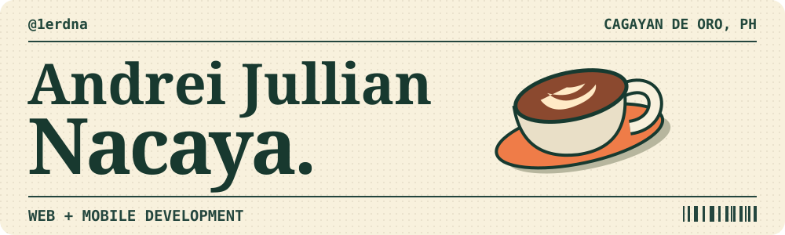

Hey, I’m **Andrei**. I was a barista and bartender before I got into web and mobile development. Working behind a busy counter still shapes how I think about software. When I look at an ordering screen, my first question is usually, *could I use this with three more orders waiting?*

[My portfolio](https://github.com/1erdna/Portfolio-Website) · [Try my speedcubing timer](https://1erdna.github.io/cubecam-connect/)

## What I’m building

**[CAPO](https://github.com/1erdna/CAPO) · Restaurant ordering and management**  
This one is close to home. CAPO is our resto bar, and I’m working on the MongoDB side of our ordering system. It’s where my experience behind the counter meets what I’m learning about databases.

**[1ERDNA Cube Lab](https://github.com/1erdna/cubecam-connect) · A timer for my speedcubing sessions**  
I wanted to put the cube down at the end of a solve and have the timer stop with me. Cube Lab uses a camera to detect my hands. I can check my average of five, replay a solve, or pair my phone as the sensor. [Give it a try →](https://1erdna.github.io/cubecam-connect/)

**[XU ThriftExchange](https://github.com/1erdna/XUThriftExchange) · A student marketplace prototype**  
Denz, Dann, and I built the mobile interface for a class project. You can browse secondhand items, save a listing, and try the reservation flow with demo data.

## On my desk

I use **JavaScript, HTML, and CSS** for browser projects. Lately I’ve been working with **MongoDB** for CAPO and practicing **subnetting and VLSM in Packet Tracer**. Give me a big host requirement and I’ll probably reach for pen and paper first.

In table tennis I play close to the table, twiddle my racket, and look for a chop-block. That habit follows me onto the pickleball court. I still like to slice the return, and right now I’m working on my backhand drive.
