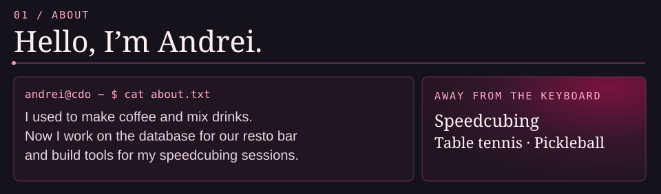
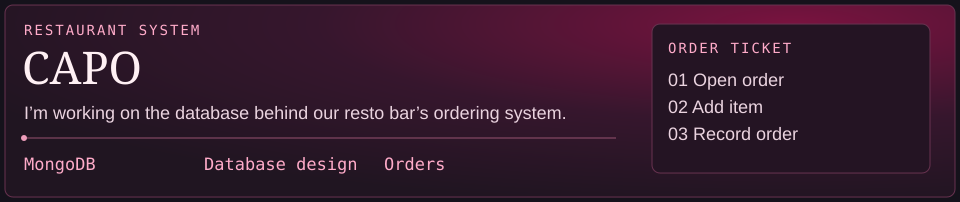
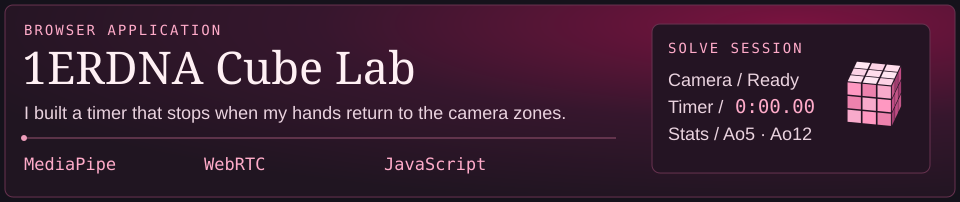
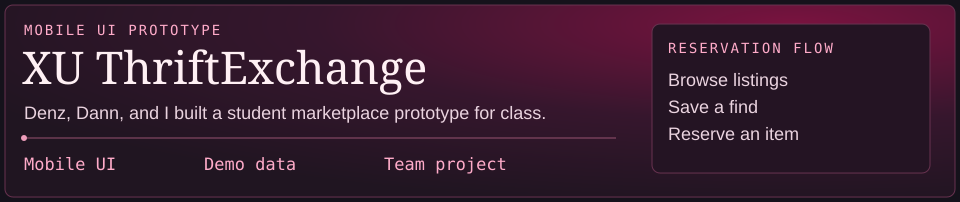

**[Portfolio ↗](https://1erdna.github.io/Portfolio-Website/)**　·　**[Cube Lab demo ↗](https://1erdna.github.io/cubecam-connect/)**　·　**[Repositories ↗](https://github.com/1erdna?tab=repositories)**

**English proficiency** · IELTS Band 7.0

Outside varsity training, I also enjoy pickleball and speedcubing.

<strong>What does a busy shift have to do with database design?</strong>

Behind the bar, I want to know what was ordered and what still needs preparing. Working on CAPO’s MongoDB database makes me think through those same questions one order at a time.

[Explore the CAPO repository ↗](https://github.com/1erdna/CAPO)

<strong>How do I try a hands-free solve?</strong>

Open Cube Lab, choose the laptop camera, and rest both hands in the marked zones. Lift them to start timing and return them to stop. You can also try the timer with the spacebar.

[Try the timer ↗](https://1erdna.github.io/cubecam-connect/)　·　[View source ↗](https://github.com/1erdna/cubecam-connect)

<strong>Try a buyer’s walkthrough</strong>

Open the UI preview from the project README. Browse a secondhand item, save it, then try reserving it. The prototype uses demo data, so you can explore the flow without an account.

[Explore the team project ↗](https://github.com/1erdna/XUThriftExchange)

[See current GitHub activity ↗](https://github.com/1erdna?tab=overview#js-contribution-activity)
